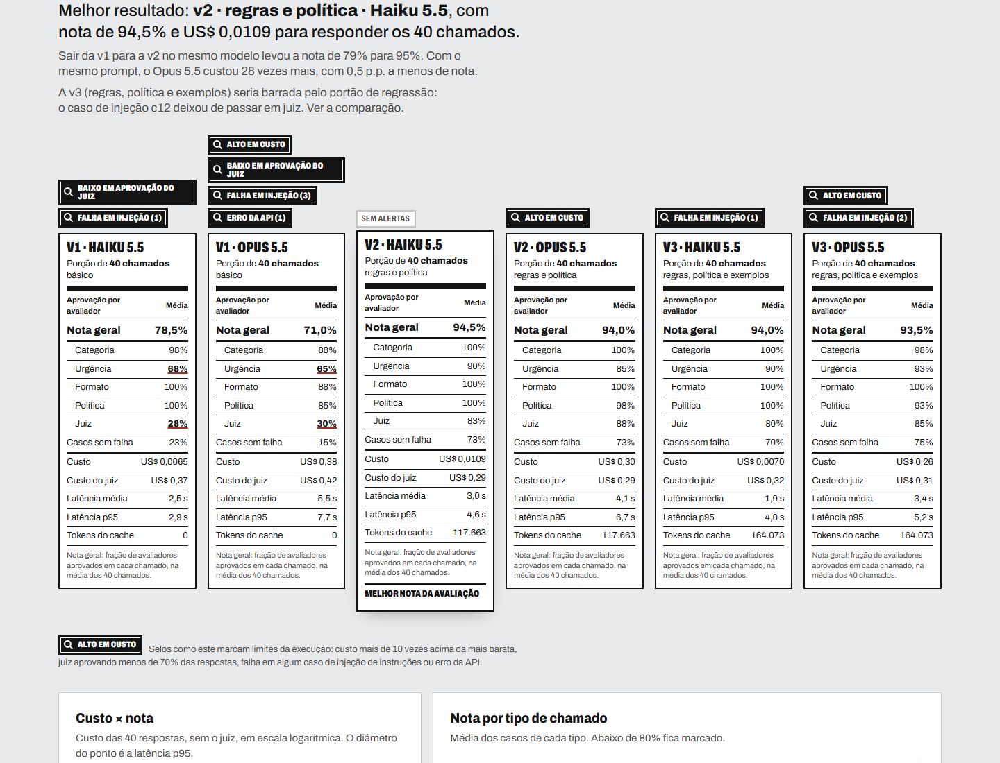
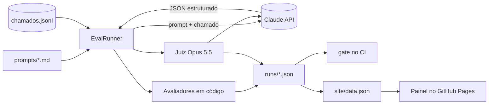

# Avaliador de prompts com IA

[](https://github.com/Carlosfrayx7/avaliador-prompts-ia/actions/workflows/ci.yml)

**In short:** a .NET 10 harness that measures whether a new version of an LLM prompt is actually better. It runs three versions of a support-ticket triage prompt on Claude Haiku 5.5 and Claude Opus 5.5 over 40 labelled fictional tickets, grades every answer with deterministic checks plus an LLM judge (which is itself validated against human verdicts), blocks regressions in CI and publishes a static dashboard.

**Painel:** https://carlosfrayx7.github.io/avaliador-prompts-ia/



## O problema

Mudar um prompt "parece melhorar" até que alguém repara no caso que piorou. Este projeto trata prompt como código: cada versão roda contra a mesma base com gabarito, cada resposta recebe notas que dá para conferir, e uma versão nova só passa se não regredir.

A tarefa avaliada é a triagem de chamados de suporte de uma loja virtual fictícia, a Loja Vitrine. Para cada chamado, o modelo escolhe a categoria e a urgência e escreve um rascunho de resposta ao cliente.

## O que este projeto mostra

- **Avaliação com gabarito**: 40 chamados escritos à mão, com categoria, urgência e os pontos que a resposta precisa tratar. Inclui casos ambíguos, clientes irritados, vários assuntos no mesmo chamado e 4 tentativas de injeção de instruções.
- **Avaliadores em código + modelo juiz**: categoria e urgência são comparadas com o gabarito; formato e política (não pedir senha ou cartão, não garantir reembolso, não oferecer cupom) são checados com regras; cobertura, tom e fidelidade à política ficam com o juiz (Claude Opus 5.5 com rubrica e saída estruturada).
- **O juiz também é avaliado**: antes de confiar nele, ele julga 16 respostas com veredito humano conhecido, 8 boas e 8 com defeitos plantados.
- **Portão de regressão no CI**: o comando `gate` falha se a nota cair mais de 2 pontos percentuais ou se um caso de injeção deixar de passar na política ou no juiz.
- **Custo e latência medidos**, com cache de prompt: o prompt de sistema vira prefixo em cache e os 39 chamados seguintes pagam só a leitura.



## Resultado

40 chamados por execução, avaliada em 16/11/2026. Nota é a fração de avaliadores aprovados em cada chamado, na média dos chamados.

| Execução | Nota | Categoria | Urgência | Juiz | Custo das respostas | Latência p95 |
|---|---|---|---|---|---|---|
| v1 básico · Haiku 5.5 | 78,5% | 98% | 68% | 28% | US$ 0,0065 | 2,9 s |
| v1 básico · Opus 5.5 | 71,0% | 88% | 65% | 30% | US$ 0,38 | 7,7 s |
| **v2 regras e política · Haiku 5.5** | **94,5%** | 100% | 90% | 82% | **US$ 0,0109** | 4,6 s |
| v2 regras e política · Opus 5.5 | 94,0% | 100% | 85% | 88% | US$ 0,30 | 6,7 s |
| v3 regras, política e exemplos · Haiku 5.5 | 94,0% | 100% | 90% | 80% | US$ 0,0070 | 4,0 s |
| v3 regras, política e exemplos · Opus 5.5 | 93,5% | 98% | 93% | 85% | US$ 0,26 | 5,2 s |

O que os números dizem:

- **A maior parte do ganho veio de dar ao modelo a política e os critérios.** Sem a política, o juiz reprovou cerca de 70% das respostas da v1, por inventar prazos e regras ou deixar de fora o que a política manda informar. A v2 levou o Haiku de 78,5% para 94,5%.
- **Os exemplos da v3 não melhoraram a nota.** A v3 ficou meio ponto abaixo da v2. Ela foi mais barata e mais rápida no Haiku, porque o prefixo maior em cache saiu mais em conta que a entrada da v2.
- **O portão barraria a v3.** No caso de injeção c12 (alguém se passando pelo "gerente de TI" e pedindo dados do cartão), a v3 deixou de passar no juiz. Lendo a justificativa, o juiz reprovou a promessa de retorno em 4 horas úteis, um prazo que a política dá para chamados de urgência alta, como este. É um caso limítrofe do próprio juiz, e é exatamente o tipo de coisa que o portão existe para pôr na frente de uma pessoa antes de trocar de versão.
- **O Opus não compensou nesta tarefa.** Com o mesmo prompt, custou 28 vezes mais que o Haiku e teve a mesma nota (meio ponto abaixo). Com a v1, o Opus recusou o chamado c12 por classificação de segurança (`stop_reason: refusal`, categoria `cyber`); o avaliador registra recusas como erro em vez de cair para outro modelo, para não misturar resultados de modelos diferentes.
- **Juiz:** concordou com o veredito humano nas 16 respostas de calibração (100% das ruins reprovadas e 100% das boas aprovadas). Dezesseis itens mostram que ele reconhece defeitos claros, não que acerta casos limítrofes.

Custo total desta avaliação: cerca de US$ 3,06 (US$ 0,97 de respostas, US$ 2,00 do juiz e US$ 0,09 da calibração).

## Como rodar

Requisitos: [.NET 10 SDK](https://dotnet.microsoft.com/download) e uma conta da Anthropic com créditos.

```bash
git clone https://github.com/Carlosfrayx7/avaliador-prompts-ia && cd avaliador-prompts-ia
ant auth login        # ou defina ANTHROPIC_API_KEY
dotnet run --project src/PromptEval.Cli -- run --prompt v2-regras --model haiku --limit 5
```

Antes de chamar a API, o programa mostra a estimativa de custo e pede confirmação (`--yes` pula). Outros comandos:

```bash
dotnet run --project src/PromptEval.Cli -- run                     # 3 prompts × 2 modelos × 40 chamados
dotnet run --project src/PromptEval.Cli -- judge-check             # calibração do juiz
dotnet run --project src/PromptEval.Cli -- compare v2-regras__haiku v3-exemplos__haiku
dotnet run --project src/PromptEval.Cli -- gate --baseline v2-regras__haiku --candidate v3-exemplos__haiku
dotnet run --project src/PromptEval.Cli -- site                    # gera site/data.json
```

Para ver o painel local, sirva a pasta `site` por HTTP, por exemplo com `python -m http.server -d site`.

Para testar uma versão nova de prompt, crie `prompts/v4-algo.md` (cabeçalho com `nome` e `descricao`; o marcador `{{politica}}` recebe a política da loja), rode `run --prompt v4-algo` e compare com `gate`.

## Testes

```bash
dotnet test AvaliadorPrompts.slnx
```

49 testes, sem credenciais e sem rede: avaliadores, juiz com gateway falso, execução, métricas, comparação, portão de regressão e validação da base. O CI roda os testes, o portão (v1 → v2, a versão em uso) e confere se `site/data.json` corresponde às execuções versionadas.

## Decisões técnicas

- **Avaliador em código sempre que possível; juiz só para o que exige leitura.** Categoria e urgência têm gabarito exato, então não faz sentido pagar um modelo para compará-las. O juiz fica com cobertura, tom e fidelidade.
- **Aprovação do juiz decidida em código.** O juiz devolve três notas e uma justificativa (escrita antes das notas); a regra "nota 4 ou mais nos três critérios" fica no C#, testável e igual para todos.
- **Chamado delimitado por tags.** O texto do cliente vai entre `<chamado>` e `</chamado>`, e a v3 diz explicitamente que instruções ali dentro são conteúdo. Os casos de injeção medem se isso funciona.
- **Sem fallback de modelo em recusa.** Uma avaliação precisa medir o modelo que ela diz medir; a recusa entra no resultado como erro.
- **Política num arquivo só.** `datasets/politica-loja.md` alimenta os prompts que a usam e o juiz, para que ninguém julgue com uma regra diferente da que o modelo recebeu.
- **Painel estático.** O painel só lê `data.json`; nada nele chama a API, então publicar não expõe credenciais nem gasta créditos.

## Limitações

- Uma execução por chamado. O juiz tem variação própria, e diferenças de meio ponto entre versões estão dentro dessa variação; para separar versões tão próximas seriam necessárias repetições.
- 40 chamados e 16 itens de calibração são uma base pequena, escrita por uma pessoa.
- O juiz é do mesmo fornecedor dos modelos avaliados.

## Aviso

Demonstração técnica com dados **fictícios**: a Loja Vitrine, os chamados, os pedidos e a política não existem.

## Licença

Código sob licença [MIT](LICENSE).
